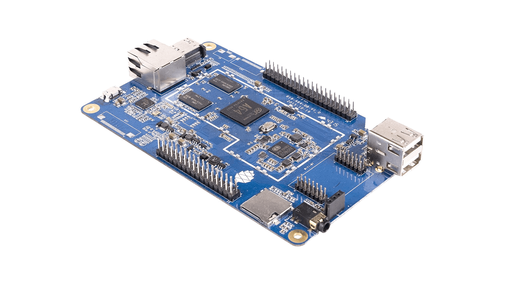

# Pine64

[Pine64 - linux-sunxi.org](https://linux-sunxi.org/Pine64)

[PINE A64 Software Releases - PINE64](https://wiki.pine64.org/wiki/PINE_A64_Software_Releases)
[Pine64 and LTS – Armbian](https://www.armbian.com/pine64/)

## Currently running

- Debian MATE desktop
- 
